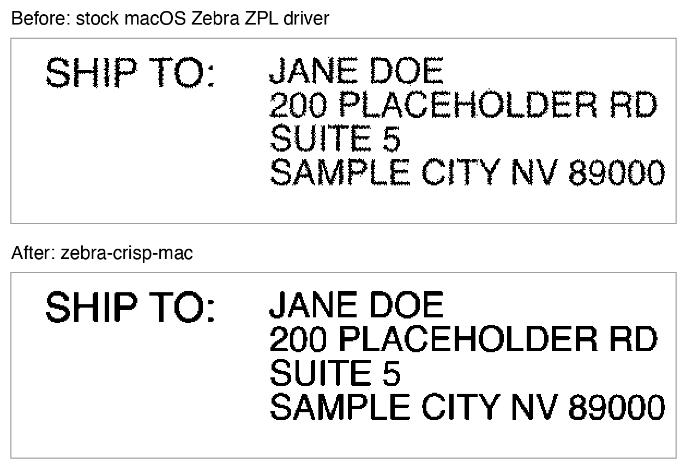

# zebra-crisp-mac

**Fixes fuzzy, grainy labels on Zebra label printers on macOS.** Free and open source.

If shipping labels from Chrome, Safari, Preview or any other Mac app come out
fuzzy or speckled on your Zebra, this replaces the one step in Apple's
built-in Zebra driver that causes it. Labels print as sharp as the printer
allows, the same as printing raw ZPL.



*The same test label through each driver, decoded from the ZPL each one sends to
the printer (203 dpi, shown at 2x).*

## Why labels print fuzzy

macOS renders each page in 1-bit black and white and **dithers** anything gray,
such as the smooth edges of text, scaled images and barcodes, into a pattern
of scattered dots. On a 203 dpi label printer those dots make every edge look
ragged. The stock driver has no setting to turn dithering off.

zebra-crisp-mac has macOS render in 8-bit grayscale instead, converts each
pixel to pure black or white with a clean threshold (no dithering): anything
darker than 25% gray prints black. It then
hands the result to Apple's own Zebra driver code. Darkness, print speed,
label top, tear-off and every other setting work exactly as before.

## Install

1. Download `ZebraCrisp-x.y.z.pkg` from the
   [latest release](https://github.com/jcl5m1/zebra-crisp-mac/releases/latest).
2. The package isn't signed with an Apple Developer ID, so the first time,
   **right-click (or Control-click) the file and choose Open**, then Open again.
   On recent macOS versions you may need to go to **System Settings > Privacy &
   Security** and click **Open Anyway**.
3. Follow the installer. It asks for your default label size (4 x 6 in for
   shipping labels is preselected). Choose **Keep Current** to leave each
   printer's size as it is.

The installer automatically switches any printer already using Apple's
**Zebra ZPL Label Printer** driver to the crisp driver and keeps its other
settings.

To add a new printer, go to **System Settings > Printers & Scanners > Add
Printer**, select your Zebra, and choose **Zebra ZPL Label Printer Crisp** under
**Use**.

### Tips for shipping labels

- Pick the label size that matches your labels, for example **4.00 x 6.00"**,
  and print at 100% scale (not "fit"). Printing a 4x6 label on a 4x5 setting
  shrinks it and softens it.
- In Chrome, set **Margins: None**. If the label image is sideways, set
  **Layout: Landscape**.
- **Line Weight** in the printer options controls how heavy thin strokes
  print by changing which grays print black: **Thin** (darker than 50% gray),
  **Normal** (darker than 25% gray, the default) or **Bold** (darker than
  12.5% gray). **Darkness** still controls how dark the printer
  burns each dot.

## Uninstall

```
sudo /Library/Printers/ZebraCrisp/uninstall.sh
```

This switches your printers back to Apple's stock Zebra ZPL driver, keeping
their settings, and removes all installed files.

## Compatibility

Tested on:

| | |
|---|---|
| macOS | 15.7.4 Sequoia (build 24G517) |
| Mac | Apple Silicon (arm64) |
| Printer | Zebra GX420d (USB), 4x6 direct thermal labels |
| Apps | Chrome |

It should work with any Zebra printer that uses Apple's built-in **Zebra ZPL
Label Printer** driver (for example GK420d, GX430t, ZP450, ZD410, ZD420) and on
Intel Macs (the package is a universal binary), but those haven't been tested
yet. Reports are welcome in
[Issues](https://github.com/jcl5m1/zebra-crisp-mac/issues). Zebra EPL and CPCL
printers aren't supported.

> **Note:** Apple has deprecated PPD-based printer drivers, including its own
> Zebra driver. They still work on current macOS, but a future release may
> remove them.

## What gets installed

| File | Purpose |
|---|---|
| `/Library/Printers/ZebraCrisp/rastertozebracrisp` | CUPS filter: thresholds the grayscale page and passes it to Apple's `rastertolabel` |
| `/Library/Printers/ZebraCrisp/uninstall.sh` | Uninstaller |
| `/Library/Printers/PPDs/Contents/Resources/ZebraCrisp.ppd` | Driver description: Apple's Zebra ZPL PPD, changed to render 8-bit grayscale and use the filter above, plus the Line Weight option |

## Build from source

Requires the Xcode Command Line Tools (`xcode-select --install`).

```
./build.sh 1.0.0
```

This produces `dist/ZebraCrisp-1.0.0.pkg`.

## License

[Apache License 2.0](LICENSE). The PPD is derived from the CUPS Zebra ZPL
driver by Apple Inc., also Apache 2.0. See [NOTICE](NOTICE).

Zebra is a trademark of Zebra Technologies. This project isn't affiliated with
or endorsed by Zebra Technologies or Apple.
